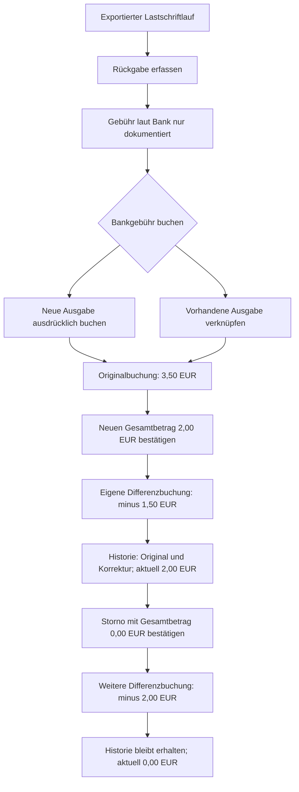

# Rücklastschriftgebühren – technischer Zwischenstand

Die bei einer Rückgabe eingetragene `return_fee_cents` bleibt eine Information aus
dem Banknachweis. Sie erzeugt weiterhin keine automatische Ausgabe und keine
zusätzliche Forderung gegen das Mitglied.

## Ausdrücklich bestätigte Bankausgabe

Der neue API-Endpunkt lautet:

`POST /api/v1/clubs/{club}/sepa-batches/{batch}/items/{item}/fee`

Er benötigt Finanzverwaltungsrechte, die Tarifberechtigungen für SEPA und
Zahlungsverfolgung, einen exportierten Lauf und eine bereits erfasste Rückgabe.
Die additive Migration `2026_09_23_000004_link_sepa_return_fee_expenses.php` muss
vorher kontrolliert eingeführt werden. Sie wurde nicht produktiv ausgeführt.

Pflichtfelder:

- `confirmed`: ausdrückliche Bestätigung.
- `amount_cents`: tatsächliche Gebühr, positive ganze Centzahl bis 99999999.
- `booked_on`: Datum der Gebührenbuchung, ab Rückgabedatum und nicht in der Zukunft.
- `reference`: eigene Bankreferenz, nach Normalisierung höchstens 180 Zeichen.

Optional verbindet `finance_entry_id` eine bereits erfasste Ausgabe. Diese muss
zum Verein, Konto `bank`, Typ `expense`, Betrag, Datum und zur Referenz passen.
Ein bereits verknüpfter Datensatz darf nicht für eine andere Rückgabe verwendet
werden. Ohne ID wird eine neue Ausgabe erstellt; eine vorhandene Bankbuchung mit
derselben normalisierten Referenz verhindert diese Neuerstellung.

Verknüpfung, neue Ausgabe und Audit-Eintrag werden gemeinsam in einer Transaktion
gespeichert. Identische Wiederholung erzeugt keine weitere Ausgabe und keinen
zusätzlichen Audit-Eintrag. Abweichende Wiederholung wird abgewiesen. Die
Finanzübersicht berücksichtigt die Ausgabe über ihre bestehende Ausgabenlogik.
Beitragsrechnung, Teilzahlungen und Restforderung bleiben unverändert.

## Schutz und noch offene Abläufe

In der Web- und App-Laufübersicht gibt es für zurückgegebene Positionen einen eigenen
Gebührendialog. Er wird erst angeboten, wenn die Gebührenmigration verfügbar ist.
Die Buchungsart muss ausdrücklich gewählt werden. Bereits gebuchte Gebühren
werden mit Betrag, Datum und Referenz angezeigt; lesende Finanzrollen erhalten
keine Buchungsaktionen.

Vorhandene Ausgaben sind über die Bankreferenz durchsuchbar. Die Suche ist auf den
Verein, Bankausgaben ab dem Rückgabedatum bis heute und nicht bereits verknüpfte
Einträge beschränkt. Sie liefert 25 Ergebnisse je Seite und ausschließlich ID,
Betrag, Datum und Referenz. Der Endpunkt lautet
`GET /api/v1/clubs/{club}/sepa-batches/{batch}/items/{item}/fee-options`.
Die ausgewählte Ausgabe wird beim Verknüpfen serverseitig erneut geprüft.

Die App bietet dieselbe Referenzsuche und Seitennavigation. Beim Verknüpfen werden
Betrag, Datum und Referenz aus der gewählten Ausgabe übernommen. Neue Ausgaben
werden getrennt eingegeben; Änderungen setzen die Bestätigung zurück. Nach einem
Transportfehler wird nicht automatisch erneut gebucht und die Bestätigung muss
erneuert werden. Nach Erfolg wird die Laufübersicht neu geladen.

Verknüpfte Ausgaben können über die bisherige allgemeine Finanzbearbeitung weder
im Web noch über die API überschrieben werden. Für normale, nicht verknüpfte
Finanzeinträge bleibt diese Bearbeitung verfügbar. Der Korrektur-/Stornoablauf ist als Backend/API umgesetzt (siehe unten);
Web- und native Korrekturoberflächen sind ergänzt; reale Abnahmen bleiben offen.

## Gebühren im bestehenden Buchhaltungsexport

Web und App bieten in den DATEV-Einstellungen das Feld `datev_fee_account` für das
fachlich festgelegte Aufwandskonto. Es gibt keinen voreingestellten Kontowert. Die
additive Migration `2026_09_23_000005_add_sepa_fee_export_account.php` stellt das
Feld bereit; sie wurde nicht produktiv ausgeführt. Ältere Clients, die dieses Feld
nicht mitsenden, löschen ein bereits gespeichertes Gebührenkonto nicht.

Der vorhandene CSV-Export berücksichtigt ausdrücklich gebuchte beziehungsweise
verknüpfte Rückgabegebühren einmalig anhand des Datums der Finanzausgabe. Der
Informationswert `return_fee_cents` wird nicht exportiert. Ein Zeitraum mit
ausschließlich Gebühren ist ebenfalls exportierbar. Gebühren stehen als
Bankabgang (`H` beim Bankkonto) mit dem konfigurierten Aufwandskonto als Gegenkonto
und mit ihrer Bankreferenz und dem Buchungsjahr im CSV.

Enthält der gewählte Zeitraum Gebühren, wird der Export vor Beginn der Ausgabe
abgewiesen, solange das Gebührenkonto fehlt, ungültig ist oder dem Bankkonto
entspricht. Zahlungsexporte ohne Gebühren benötigen dieses zusätzliche Konto
nicht. Allgemeine, nicht mit Rückgaben verknüpfte Finanzausgaben sind weiterhin
nicht Bestandteil dieses Zahlungsexports. Dies ist eine Erweiterung des bestehenden
CSV-Formats; eine tatsächliche Übernahme in die eingesetzte Buchhaltungssoftware
und die fachliche Kontenzuordnung müssen noch abgenommen werden.

Offen sind außerdem Browser-/Realgeräteabnahme, fachlich
bestätigte Weiterbelastungen an Mitglieder sowie reale Bank-/MySQL-Abnahme.
Es wurden keine produktiven Bankbuchungen oder Mitgliederforderungen erstellt.

Ein technisches Zurücknehmen der Migration entfernt die Gebührenverknüpfungen;
vorhandene Finanzausgaben bleiben erhalten. Nach produktiver Nutzung erfordert ein
solcher Rückbau daher eine eigene Datensicherung und Abgleichplanung. Der
automatisierte Migrationstest prüft nur den Rückbau vor der ersten Gebührenbuchung.

## Gebührenkorrekturen: Backend/API

Die additive Migration `2026_09_23_000006_create_sepa_fee_corrections.php` ergänzt
unveränderlich fortgeschriebene Korrekturdatensätze; sie ist nicht produktiv
angewendet. Web- und nativer App-Dialog sind implementiert.

`POST /api/v1/clubs/{club}/sepa-batches/{batch}/items/{item}/fee-corrections`
verlangt dieselben Finanzverwaltungs- und Tarifrechte wie die Gebührenbuchung.
Pflichtfelder sind `confirmed`, `request_id` (UUID), `expected_revision` (zuerst 0),
`amount_cents` (neuer Gesamtbetrag, 0 bis 99999999), `booked_on`, `reference` und
`reason`. Null Cent bedeutet vollständiges Storno; spätere Korrekturen bleiben
möglich. Änderungen von Datum/Referenz allein sind noch kein unterstützter Ablauf.

Die ursprüngliche Ausgabe wird weder überschrieben noch gelöscht. Stattdessen
entsteht eine vorzeichenbehaftete Differenzausgabe mit eigener Referenz und Datum.
Eine Verringerung vermindert damit Ausgaben, statt zusätzliche Einnahmen zu
erfinden. Mitgliedsbeitrag, Zahlungen und Restforderung bleiben unverändert.
Korrekturdatum ist frühestens das Datum der letzten Gebührenbuchung/Korrektur und
spätestens heute. Bereits verwendete Bankreferenzen werden abgewiesen.

Jede Korrektur speichert Bearbeiter, Begründung, bisherigen/neuen Centbetrag,
Revision und die Differenzbuchung. Eine identische Wiederholung derselben UUID
liefert nur den vorhandenen Datensatz; abweichender Inhalt oder ein veralteter
Bearbeitungsstand wird abgewiesen. Nach einem unklaren Transportfehler muss ein
Client denselben Schlüssel und Inhalt verwenden oder den aktuellen Stand lesen.
Die Laufübersicht liefert `fee_corrections_available` und `fee_corrections` je
Ergebnis. Der dortige `fee_entry` bleibt ausdrücklich die ursprüngliche Buchung;
der aktuelle Gesamtbetrag steht in der höchsten Korrekturrevision.

Differenzbuchung, Korrekturhistorie und Audit werden gemeinsam gespeichert oder
zurückgerollt. Die allgemeine Finanzbearbeitung kann weder Original- noch
Korrekturbuchungen überschreiben. Korrekturen stehen nicht zur erneuten Verknüpfung
als Gebühr einer anderen Position zur Auswahl. Der CSV-Export enthält jede
Differenzbuchung in ihrem eigenen Zeitraum; negative Ausgabenkorrekturen verwenden
einen positiven CSV-Betrag mit `S`, Erhöhungen mit `H`. Frühere Perioden bleiben
unverändert. Eine echte Buchhaltungsübernahme ist weiterhin offen.

Nach produktiver Nutzung darf die Korrekturtabelle nicht einfach zurückgebaut
werden: Sonst bleiben Differenzausgaben ohne Korrekturzuordnung zurück. Ein Rückbau
braucht eine eigene Sicherungs- und Abgleichplanung.

## Web-Korrekturformular

Die Laufübersicht zeigt ursprüngliche Buchung, aktuellen Gesamtbetrag und
Korrekturhistorie. Finanzverwaltungspersonen können bei verfügbarer Migration den
neuen Gesamtbetrag, Datum, eine eigene Referenz und Begründung bestätigen. Null
storniert die Gebühr vollständig. Lesende Rollen sehen ausschließlich den Stand
und die Historie. Texte sind in DE/EN/FR/AR vorhanden.

Nach einem Fehler bleibt die ursprüngliche Anfrage einschließlich UUID eingefroren.
Eine neue Bestätigung sendet exakt denselben Inhalt erneut; ein automatischer
Wiederholungsversuch findet nicht statt. Alternativ wird der aktuelle Serverstand
neu geladen. Solange diese Aktualisierung scheitert, bleiben die ursprünglichen
Eingaben gesperrt. Auch nach Erfolg ist keine zweite Buchung vor Aktualisierung
möglich. Die UUID benötigt einen Browser mit sicherem Kontext und
`crypto.randomUUID`; ohne diese Fähigkeit wird keine Anfrage gesendet.

Zustands- und serverseitige Komponentenrenderprüfungen sowie der isolierte Build
sind bestanden. Echte Browserbedienung, Tastatur/RTL und die native Korrekturansicht
sind noch auf realen Geräten abzunehmen.

## Native Korrekturoberfläche

Die App zeigt aktuellen Betrag und lesende Historie in der Laufübersicht. Nur
Finanzverwaltungspersonen erhalten bei Serverfreigabe die Korrekturaktion. Der
Dialog bestätigt Betrag, Datum, Referenz und Begründung; eine Änderung setzt die
Bestätigung zurück. Null storniert vollständig. Ungültige Beträge und Datumswerte
werden vor dem Versand abgewiesen, zusätzlich bleiben Serverprüfungen maßgeblich.

Die App erzeugt je logischer Anfrage eine UUID v4 mit `Random.secure`. Nach einem
unklaren Fehler bleiben derselbe Schlüssel und Payload eingefroren. Wiederholung
ist nur nach erneuter Bestätigung möglich und nutzt dieselbe Anfrage. Weder
Offline-Warteschlange noch automatischer Retry werden verwendet. Die Übersicht
wird auch nach Zurücknavigation neu geladen; Zurück ist während der Übertragung
gesperrt. Bei einem Fehler beim Neuladen zeigt die Übersicht diesen Fehler; der
Server schützt weitere Aktionen mit der erwarteten Revision vor veraltetem Stand.

Automatisierte Bedienungs- und Navigationstests prüfen diese Abläufe sowie lesende
arabische Historie. Diese Prüfungen ersetzen keine reale Geräteabnahme.

## T21-13 – Bankgebühr: Prüfung vom 28.11.2026

Web und App zeigen die ursprüngliche Gebührenbuchung jetzt ausdrücklich mit
Buchungsnummer, Betrag, Datum und Referenz. Jede Korrektur enthält zusätzlich zur
Änderung „vorher → nachher“ die separat gebuchte Differenz mit Vorzeichen und ihre
eigene Buchungsnummer. Der aktuelle Gesamtbetrag bleibt separat sichtbar. Die
Originalangaben stehen auch im nativen Korrekturdialog. Die Texte sind in
Deutsch, Englisch, Französisch und Arabisch vorhanden.

Die Web-Betragsprüfung liest ganze Cent direkt aus den eingegebenen Ziffern.
Dadurch werden gültige Beträge wie 4,10 EUR und 0,29 EUR nicht mehr durch einen
exakten Gleitkommavergleich abgewiesen. Mehr als zwei Nachkommastellen werden
nicht still gerundet. Web und App weisen zukünftige Korrekturdatumswerte vor dem
Versand ab; das Web prüft außerdem auf tatsächlich existierende Kalendertage.
Die Servervalidierung und der Wiederholungsschutz bleiben maßgeblich.

### Klick-für-Klick auf dem Handy

Voraussetzung: Finanzverwaltungsrechte, freigeschaltete SEPA-/Zahlungsfunktionen
und ein bereits exportierter Lastschriftlauf. Für einen Test einen Testverein
und passende Testbelege verwenden. Die folgenden Beträge sind ein Beispiel.

1. Den gewünschten Verein öffnen und **Mitglieder & Beiträge** aufrufen.
2. In der Bereichsauswahl **Export** wählen. Zum Abschnitt
   **SEPA-Sammellauf** scrollen und **SEPA-Sammellauf** antippen.
3. In **Lastschriftläufe** den passenden Lauf mit Status **Exportiert** und
   darunter die richtige Rechnung/Mitgliedsposition anhand ihrer Referenzen suchen.
4. Falls noch keine Rückgabe dokumentiert ist: **Rückgabe erfassen** antippen.
   **Buchungsdatum laut Bank** im Format `TT.MM.JJJJ`, die eindeutige
   Bank-Buchungsreferenz, den Rückgabegrund und beispielsweise `3,50` in
   **Bankgebühr (EUR)** eintragen. Bankbeleg bestätigen und **Rückgabe erfassen**
   antippen. Dieser Gebührenwert dokumentiert den Beleg; er bucht noch keine Ausgabe.
5. An derselben Position **Bankgebühr buchen** antippen.
6. Unter **Buchungsweg auswählen** den passenden Weg wählen:
   **Neue Ausgabe anlegen** für eine noch nicht erfasste Gebühr; andernfalls
   **Vorhandene Ausgabe verknüpfen**, die Bankreferenz suchen und die passende
   Ausgabe auswählen. Eine vorhandene Ausgabe nicht nochmals neu anlegen.
7. Bei einer neuen Ausgabe `3,50` als **Gebühr in EUR**, das tatsächliche
   **Buchungsdatum** und eine eigene **Bankreferenz** eintragen. Die Angaben
   bestätigen und **Ausgabe buchen** beziehungsweise **Ausgabe verknüpfen** antippen.
8. In der aktualisierten Übersicht **Ursprüngliche Gebührenbuchung** mit
   Buchungsnummer, `3,50 EUR`, Datum und Referenz kontrollieren.
9. **Gebühr korrigieren oder stornieren** antippen. Unter **Neuer Gesamtbetrag in
   EUR** beispielsweise `2,00` eintragen. Das ist der neue Gesamtbetrag.
   **Korrekturdatum**, eine neue **Eigene Buchungsreferenz** und eine konkrete
   **Begründung** ergänzen. Das Datum muss zwischen der letzten Gebührenbuchung
   beziehungsweise Korrektur und heute liegen.
10. Die Angaben prüfen, die Bestätigung aktivieren und **Korrektur buchen** antippen.
11. Nach Rückkehr **Korrekturhistorie** aufklappen. Erwartet: Original weiterhin
    `3,50 EUR`, Korrektur `3,50 → 2,00 EUR`, **Separat gebuchte Differenz**
    `−1,50 EUR` mit eigener Buchungsnummer, Datum, Referenz und Begründung.
    **Aktueller Gebührenbetrag** zeigt `2,00 EUR`.
12. Für ein vollständiges Storno denselben Korrekturweg mit neuem Gesamtbetrag
    `0,00`, neuer Referenz und Begründung verwenden. Die zweite Differenz beträgt
    dann `−2,00 EUR`; Original und beide Korrekturen bleiben erhalten.

Bei unklarem Übertragungsergebnis **Aktuellen Stand laden** wählen oder dieselbe
Korrektur nach erneuter Bestätigung über **Dieselbe Korrektur erneut prüfen**
wiederholen. Die eingefrorene Anfrage behält ihre Kennung; es wird nicht
automatisch erneut gebucht. Die Mitgliedsforderung wird durch die Bankgebühr
und ihre Korrekturen nicht erhöht oder vermindert.

### Lokale Prüfergebnisse

- 38 Backend-Tests mit 661 Assertions bestanden (`ClubSepaSettlementTest`,
  Filter `fee_`, SQLite im Arbeitsspeicher). Der neue Verlaufstest prüft
  Verringerung, Erhöhung und Storno, vier getrennte Buchungen, unveränderte
  Originaldaten, API-Historie, identische Wiederholungen, Audit und Mitgliedsschuld.
- 11 Webtests für Centbeträge, Korrekturzustand und gerenderte Historie bestanden.
- 28 Flutter-Tests für Gebühr, Korrektur und Lastschriftlauf bestanden; darunter
  320-Pixel-Handybreite, deutsche Buchungsdetails und lesende arabische Historie.
- Gezielte Dart-Analyse ohne Befund; isolierter Vite-Build erfolgreich.

Es wurden keine produktiven Buchungen, Migrationen oder Veröffentlichungen
ausgeführt. Eine reale Handy-/Bank-/MySQL-Abnahme ist damit nicht behauptet.
