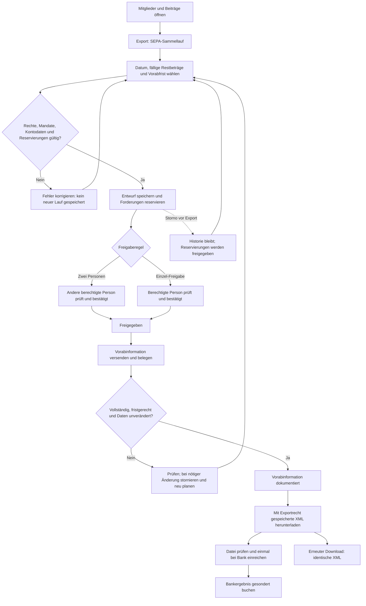

# T21-09 SEPA-Lauf am Handy

Stand: 28.11.2026. Diese Anleitung beschreibt gespeicherte SEPA-Sammelläufe in der Airmius-App und die entsprechende Webansicht. Ein Lauf reserviert ausgewählte Forderungen, wird freigegeben und nach dokumentierter Vorabinformation als Bankdatei exportiert. Der Download löst keine Bankzahlung aus und markiert Rechnungen nicht als bezahlt.

## Vor dem Start

- Melde dich im richtigen Verein an. Der Verein benötigt die Funktion `sepa_export` im Tarif.
- Für die Übersicht brauchst du Finanz-Leserechte, zum Vorbereiten und Dokumentieren Finanzverwaltung, zum Freigeben die Freigabeberechtigung und für die XML-Datei die Exportberechtigung. Diese Aktionsrechte können getrennt vergeben oder entzogen sein.
- Hinterlege das Vereinskonto und die Gläubiger-ID. Jeder Zahler benötigt ein aktives Mandat mit IBAN, Mandatsreferenz und einem Unterschriftsdatum, das nicht in der Zukunft liegt. Eine angegebene BIC muss ein gültiges Format haben.
- Verwende offene oder überfällige Rechnungen mit positivem Restbetrag. Ihre Fälligkeit muss spätestens am Einzugstag liegen. Bereits in einem anderen Lauf reservierte Rechnungen sind gesperrt.
- Kläre die vereinbarte Vorabfrist. Das Formular startet mit 14 Tagen; dieser Vorschlag ersetzt keine bestehende Vereinbarung. Die App lässt 1 bis 60 Tage zu und prüft den Abstand zum Einzugsdatum.

## Klick für Klick in der App

1. Öffne den betreffenden Verein und **Mitglieder & Beiträge**.
2. Wechsle zum Reiter **Export**. Tippe im Bereich **SEPA, DATEV & Regeln** auf **SEPA-Sammellauf**. Für den hier beschriebenen kontrollierten Ablauf verwende diesen Einstieg. **SEPA exportieren** ist ein separater älterer Exportweg.
3. Auf **Lastschriftläufe** tippe bei Bedarf rechts oben auf **Aktualisieren**. Prüfe die **Freigaberegel**: Standard ist **Zwei-Personen-Freigabe**.
4. Tippe auf **Lauf vorbereiten**. Das Dialogfenster ist scrollbar.
5. Trage bei **Einzugsdatum** das Datum im Format `TT.MM.JJJJ` ein. Rechnungen mit späterer Fälligkeit verschwinden aus der Auswahl. Bei einer Datumsänderung werden nicht mehr passende Häkchen entfernt.
6. Wähle die gewünschten Rechnungen. Vergleiche Rechnungsnummer, **Fällig am** und Restbetrag. Bereits reservierte Rechnungen sind ausgeblendet, auch wenn ihr Lauf erst auf einer weiteren Seite steht.
7. Prüfe **Ausgewählt** und **Gesamt**. Beispiel: Eine Rechnung über 100,00 EUR mit bereits verbuchten 20,00 EUR wird mit 80,00 EUR eingezogen. Höchstens 200 Rechnungen passen in einen Lauf.
8. Prüfe **Vereinbarte Vorabfrist in Tagen** und tippe im Dialog auf **Lauf vorbereiten**. Der Server prüft Rechnungen, Mandate, Kontodaten und Reservierungen erneut. Scheitert eine Position, wird der gesamte neue Lauf verworfen.
9. Suche die neue Karte mit Status **Entwurf**. Prüfe Empfänger, Beträge, Mandatsreferenzen, letzte vier IBAN-Stellen, Gläubiger-ID und Einzugsdatum. Notiere die Laufreferenz.
10. Bei **Zwei-Personen-Freigabe** meldet sich eine andere berechtigte Person an, öffnet denselben Lauf und tippt auf **Freigeben**. Sie prüft den Bestätigungstext und tippt auf **Bestätigen**. Die erstellende Person kann ihren eigenen Entwurf in diesem Modus nicht freigeben.
11. Bei bereits eingerichteter **Einzel-Freigabe** kann eine berechtigte Person auch ihren eigenen Lauf mit derselben ausdrücklichen Bestätigung freigeben. Nur der Vereinsbesitzer kann über das Zahnrad bei **Freigaberegel** den Modus ändern. Die Änderung gilt auch für vorhandene Entwürfe und wird protokolliert.
12. Nach der Freigabe organisiere die Vorabinformation für sämtliche aufgeführten Zahler. Für bereits extern versandte Informationen tippe auf **Versand dokumentieren**. Trage **Versendet am**, **Versandweg** und **Versandnachweis / Ablagereferenz** ein. Bestätige den Versand an alle Zahler und speichere. Diese Dokumentation verschickt selbst keine Nachricht.
13. Falls der integrierte E-Mail-Versand angeboten wird: Tippe auf **Vorabinformationen vorbereiten**, öffne **Nachrichten prüfen**, kontrolliere Inhalte und Empfänger, setze die Versandbestätigung und tippe auf **Vorabinformationen senden**. Aktualisiere anschließend den Status. Bei unklarem Versand oder Zurückweisung prüfe den tatsächlichen Versand, bevor du fortfährst. Einzelheiten stehen in `CLUB_SEPA_NOTICE_DELIVERY_FEEDBACK.md`.
14. Sobald der Lauf **Vorabinformation dokumentiert** anzeigt, tippe mit Exportberechtigung auf **Bankdatei herunterladen**. Wähle im Dateidialog einen Speicherort für die XML-Datei. Wird der Speicherdialog abgebrochen, kann der Lauf bereits als **Exportiert** gespeichert sein; derselbe Download kann erneut aufgerufen werden.
15. Prüfe die Datei anhand der Laufkarte: Einzugsdatum, Anzahl der Positionen, Gesamtsumme und Einzelbeträge. Reiche sie anschließend nur einmal bei der Bank ein. Eine Wiederholung des Downloads liefert dieselbe gespeicherte Datei; sie verhindert keine doppelte manuelle Einreichung bei der Bank.

Nach erfolgreichem Export bleibt die Forderung offen, bis ein tatsächlicher Zahlungseingang gebucht wird. Bankergebnisse und Rücklastschriften gehören zu den gesonderten Folgeabläufen.

## Am Handy im Webbrowser

Öffne die Vereinsverwaltung für Mitglieder und Beiträge und den Bereich **Lastschriftläufe**. Tippe auf **Lastschriftläufe öffnen**. Die Felder für Rechnungsauswahl, Einzugsdatum und Vorabfrist stehen direkt in der Ansicht. Zum Freigeben muss das Kontrollkästchen **Ich habe Empfänger, Beträge und Einzugsdatum dieses Laufs geprüft und gebe ihn frei.** gesetzt sein. Der eingestellte Einzel- oder Zwei-Personen-Modus wird berücksichtigt. Die weiteren Schritte entsprechen dem Ablauf oben; der Browser übernimmt den XML-Download.

## Wenn etwas nicht funktioniert

| Beobachtung | Nächster Schritt |
| --- | --- |
| Eine Aktion fehlt | Aktionsrecht prüfen: Verwaltung, Freigabe und Export sind getrennt. Danach aktualisieren. |
| Keine passenden offenen Rechnungen | Einzugsdatum, Reservierungen und aktuelle Rechnungsliste prüfen. Die Auswahl basiert auf den geladenen Rechnungen; gegebenenfalls zur Rechnungsübersicht zurückkehren und neu laden. |
| Mandat wird abgelehnt | Aktivierung, Unterschriftsdatum, nicht leere Mandatsreferenz mit höchstens 35 Zeichen, IBAN und gegebenenfalls BIC korrigieren. |
| Fälligkeit liegt nach dem Einzug | Einzugsdatum korrigieren oder die betreffende Rechnung abwählen. |
| Vorabfrist ist zu kurz | Einen passenden Einzugstermin wählen. Eine bereits verstrichene Frist lässt sich nicht durch rückdatierten Versand ersetzen. |
| Betrag, Mandat oder Vereinskonto hat sich geändert | Einen noch nicht exportierten Lauf mit nachvollziehbarem Grund stornieren und nach Prüfung neu vorbereiten. |
| Speichern meldet einen Verbindungsfehler | Erst aktualisieren und prüfen, ob der Lauf bereits existiert. Nicht blind erneut anlegen. SEPA-Schreibaktionen werden nicht offline eingereiht oder automatisch wiederholt. |
| Exportierter Lauf soll geändert werden | Keine einfache Stornierung möglich. Zuerst den Bankstatus klären; die Reservierung bleibt bestehen. |

## Ablaufdiagramm

## Technischer Prüfumfang von T21-09

Die Tests prüfen Fälligkeit zum Einzugsdatum, offenen positiven Restbetrag, Teilzahlungen bis auf den Cent, vereinsfremde und doppelte IDs, aktive Reservierungen über die Seitengrenze hinweg, Mandatswiderruf, zukünftige Unterschrift, IBAN-Prüfsumme, BIC-Format, getrennte Aktionsrechte, Einzel-/Zwei-Personen-Freigabe, dokumentierte Vorabfrist und unveränderte Daten bis zum ersten Export. Ein Fehler rollt den gesamten neuen Lauf zurück. Der Datenbank-Unique-Index auf `reserved_invoice_id` sichert die Reservierung zusätzlich ab.

Geprüft werden auch XML-Positionszahl, Kontrollsumme, Einzelbeträge und identische Wiederholungsdownloads. Export erzeugt keine Zahlung. Diese technischen Prüfungen bestätigen weder die Existenz eines Bankkontos noch die Annahme einer Datei durch eine bestimmte Bank; eine bankseitige Einreichung wurde nicht durchgeführt. Die XML-Erzeugung verwendet weiterhin das vorhandene Format `pain.008.001.02`.

Relevante Tests:

- `tests/Feature/ClubSepaBatchTest.php`
- `tests/Feature/ClubSepaNoticeTest.php`
- `tests/Feature/ClubSepaSettlementTest.php`
- `tests/Unit/ClubMembershipSepaServiceTest.php`
- `tests/Frontend/sepaBatchWorkflowRender.test.mjs`
- `tests/Frontend/sepaNoticeProviderFeedbackRender.test.mjs`
- `mobile/airmius_mobile/test/club_sepa_batch_test.dart`

Automatisierte Prüfung am 28.11.2026: 111 PHP-Tests mit 1.492 Assertions, 23 Flutter-Tests und sechs Webtests erfolgreich. Die PHP-Suite läuft mit SQLite im Arbeitsspeicher, temporärem Testschlüssel und `memory_limit=512M`. Die Webtests kompilieren und rendern die Vue-Komponente; die App-Tests verwenden einen simulierten API-Transport. Eine reale Bankeinreichung oder ein vollständiger manueller Durchlauf auf einem Telefon ist damit nicht nachgewiesen.

Die ältere Funktion **SEPA exportieren** wird hier nicht als kontrollierter Lauf behandelt. Sobald ein nicht stornierter gespeicherter Lauf existiert, blockiert sie bereits der vorhandene Servercode. Die Änderungen zu T21-09 ersetzen diesen separaten Altpfad nicht.
