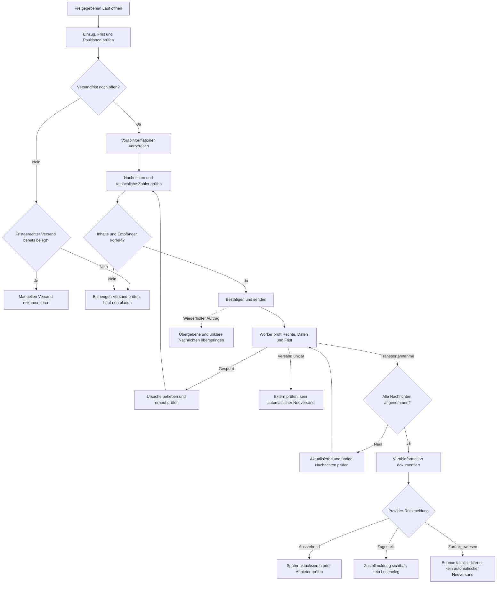

# T21-10 – SEPA-Vorankündigung am Handy

Diese Anleitung beschreibt die App und die implementierte Versandlogik. Voraussetzung sind Internetzugang, die freigeschaltete SEPA-Funktion, Finanzverwaltungsrechte und ein freigegebener Lastschriftlauf. Für echten E-Mail-Versand müssen Billing-Mailtransport und Queue-Worker eingerichtet sein.

## 1. Den richtigen Lauf öffnen

1. Öffne deinen Verein im Vereins-Cockpit.
2. Öffne **Mitglieder & Beiträge** beziehungsweise **Finanzen**.
3. Wähle in der Bereichsauswahl **Export**.
4. Tippe unter **SEPA, DATEV & Regeln** auf die Schaltfläche **SEPA-Sammellauf**. Es öffnet sich **Lastschriftläufe**.
5. Suche den Lauf anhand seiner Referenz und kontrolliere **Einzugsdatum**, Positionen, offene Beträge und Mandatsreferenzen. Für die nächsten Schritte muss sein Status **Freigegeben** sein. Bei einem Entwurf ist zuerst die vorgesehene Freigabe nötig.

## 2. Frist und Empfänger prüfen

1. Lies **Spätester Versandtag** und **Vereinbarte Vorabfrist in Tagen**. Die Anwendung berechnet den Versandtag aus Einzugsdatum minus eingetragener Vorabfrist in Kalendertagen. Beispiel: Einzug am 10.10.2026 und 14 Tage Vorabfrist ergeben den 26.09.2026. Verwende die für diesen Lauf vereinbarte Frist.
2. Tippe auf **Vorabinformationen vorbereiten**. Dies speichert die Vorschau, versendet aber noch keine E-Mail.
3. Öffne **Nachrichten prüfen**. Kontrolliere jede Empfängeradresse, den Betreff und den Nachrichtentext: Betrag, Einzugsdatum, Gläubiger-ID, Mandatsreferenz und Rechnung müssen passen. Die vollständige IBAN wird nicht im Nachrichtentext angezeigt.
4. Die Adresse stammt vom Benutzer der jeweiligen Rechnung. Prüfe deshalb ausdrücklich, dass sie den tatsächlichen Beitragszahler erreicht. Abweichende Zahler werden nicht automatisch ermittelt. Pro Rechnungsposition entsteht eine Nachricht; mehrere Rechnungen derselben Person können mehrere berechtigte Nachrichten ergeben.
5. Bei einer falschen Adresse oder abweichendem Zahler nicht bestätigen. Die Vorschau ist eingefroren; spätere Adressänderungen werden nicht stillschweigend übernommen. Prüfe den bisherigen Versand und plane gegebenenfalls einen neuen Lauf oder den unten beschriebenen manuellen Versandweg.

**Wenn die Frist abgelaufen ist:** Die App zeigt einen Hinweis und deaktiviert Vorbereitung beziehungsweise E-Mail-Versand. Ein bereits fristgerecht erfolgter Versand kann mit echtem Nachweis dokumentiert werden. Andernfalls den Lauf stornieren und mit späterem Einzugsdatum neu vorbereiten. Auch der Queue-Worker prüft die Frist unmittelbar vor dem Versand; eine rechtzeitige Einreihung allein genügt nicht.

## 3. Senden und Ergebnis laden

1. Tippe auf **Vorabinformationen senden**.
2. Lies die Bestätigung und setze das Häkchen erst nach der Prüfung aller Inhalte und Empfänger.
3. Tippe im Dialog auf **Vorabinformationen senden**. **Abbrechen** schließt den Dialog ohne Versandauftrag.
4. Tippe anschließend oben auf das Aktualisieren-Symbol (**Aktualisieren**). Öffne **Nachrichten prüfen** erneut. Wiederhole das Aktualisieren, solange Aufträge verarbeitet werden.
5. Sobald alle Nachrichten vom Mailtransport angenommen wurden und die Frist eingehalten ist, wechselt der Lauf zu **Vorabinformation dokumentiert**. Dies ist keine Bestätigung, dass die Empfänger die E-Mails gelesen haben.

## 4. Status verstehen und Fehler bearbeiten

| Anzeige | Bedeutung und nächster Schritt |
| --- | --- |
| Vorbereitet | Vorschau gespeichert. Nach Prüfung explizit senden. |
| In Warteschlange | Auftrag wartet auf den Worker. Aktualisieren; bei dauerhaftem Stillstand Queue-Betrieb prüfen lassen. |
| Wird gesendet | Ein Worker hat die Nachricht übernommen. Abwarten und aktualisieren. |
| An Mailtransport übergeben | Transportannahme gespeichert. Diese Nachricht wird nicht erneut versendet. |
| Zustellmeldung des Anbieters ausstehend | Noch keine zugeordnete Rückmeldung. Bei einem Transport ohne unterstützte Rückmeldungen kann dieser Status bestehen bleiben. |
| Vom Mailanbieter als zugestellt bestätigt | Zustellmeldung liegt vor; kein Lese- oder persönlicher Empfangsnachweis. |
| Vom Mailanbieter zurückgewiesen | Bounce prüfen und Ursache mit zuständiger Verwaltung klären. Kein automatischer Neuversand. |
| Versand gesperrt | Rechte, Mitglied/Mandat, Rechnung, Empfänger, Vorabfrist und Mailkonfiguration prüfen. Nur nach Behebung erneut senden. Eine geänderte Adresse wird nicht in die alte Vorschau übernommen. |
| Versand unklar – extern prüfen | Der Versand könnte erfolgt sein. Zuerst Mailanbieter und Versandnachweise prüfen; nicht blind einen neuen Lauf anlegen und senden. |
| Versand abgebrochen | Wartender Versand wurde etwa durch Stornierung oder dokumentierten manuellen Versand beendet. |

Ein länger als zehn Minuten unterbrochener Versand erscheint beim Aktualisieren als **Versand unklar – extern prüfen**. Die Statusabfrage selbst verschickt keine Nachricht. Ein Warnhinweis zu gesperrten, unklaren oder zurückgewiesenen Nachrichten ist bereits außerhalb der zugeklappten Vorschau sichtbar.

Ein späterer Bounce ändert den bestehenden Laufstatus und eine bereits erzeugte Bankdatei nicht automatisch. Vor weiteren Schritten die Zustellung fachlich klären; der Laufstatus allein beantwortet diese Frage nicht.

## 5. Wiederholen ohne unbeabsichtigte Duplikate

1. Nach Verbindungsabbruch zuerst **Aktualisieren** und den gespeicherten Zustand prüfen.
2. Erneutes Vorbereiten desselben freigegebenen Laufs erzeugt keine zusätzlichen Nachrichten und verändert die bestehende Vorschau nicht.
3. **Vorabinformationen senden** berücksichtigt nur vorbereitete, wartende oder gesperrte Nachrichten. Wiederholte Queue-Aufträge werden durch die einzelne Versandübernahme abgesichert.
4. Bereits übergebene, unklare, laufende oder abgebrochene Nachrichten werden nicht erneut versendet. Bei ausschließlich solchen Zuständen bietet die App keine Sendeschaltfläche an. Ein wiederholter API-Aufruf nach vollständig abgeschlossenem E-Mail-Versand liefert das gespeicherte Ergebnis ohne neuen Auftrag, auch nach Export oder späterem Fristablauf.
5. Ein neuer Lauf ist ein eigener Vorgang. Der Schutz des alten Laufs verhindert keine separat veranlasste neue Nachricht. Vor Stornierung und Neuanlage daher bisherigen Versand und mögliche unklare Ergebnisse prüfen.

## 6. Bereits erfolgten manuellen Versand dokumentieren

1. Erreiche die tatsächlichen Zahler über den vorgesehenen externen Versandweg und bewahre einen Nachweis auf.
2. Tippe beim freigegebenen Lauf auf **Versand dokumentieren**.
3. Trage **Versendet am**, **Versandweg** und **Versandnachweis / Ablagereferenz** ein. Der Versandtag darf nicht in der Zukunft oder vor dem Freigabetag liegen und muss die Vorabfrist einhalten.
4. Bestätige den bereits erfolgten Versand an alle aufgeführten Zahler und speichere. Diese Aktion sendet selbst keine E-Mail und beendet noch wartende E-Mail-Aufträge. Ein gerade laufender Versand muss zuerst geklärt werden.

## Ablaufdiagramm

## Abnahme und Grenzen

Lokaler Prüfnachweis vom 28.11.2026:

- `php vendor/bin/phpunit tests/Feature/ClubSepaNoticeTest.php tests/Feature/ClubSepaBatchTest.php`: 36 Tests bestanden. Der anschließend um Wiederholung während eines Teilversands ergänzte Test wurde zusätzlich einzeln erfolgreich ausgeführt.
- `flutter test --no-pub test/club_sepa_batch_test.dart`: 26 Tests bestanden, darunter der bestätigte Versand auf einer 390 Pixel breiten Handyansicht.
- `node --test tests/Frontend/sepaNoticeProviderFeedbackRender.test.mjs tests/Frontend/sepaNoticeWorkflowRender.test.mjs`: 6 Tests bestanden.
- Gezielte Dart-Analyse: keine Fehler oder Warnungen; ein bereits vorhandener Stilhinweis zur fehlenden Blockklammer im Test-Fixture.

Die automatisierten Tests verwenden Testdaten und simulierte Mailtransporte. Sie prüfen Vorbereitung ohne Versand, eingefrorene Inhalte, Empfänger, Fristgrenzen, Rechte, Bestätigung, Einzelübernahme, Wiederholung, Fehler und Provider-Rückmeldungen sowie die Anzeige in Web und App. Eine echte Postmark-Zustellung, ein kontrollierter Bounce und ein produktiver Worker-Neustart benötigen weiterhin die gesonderte Betriebsabnahme aus [CLUB_SEPA_NOTICE_DELIVERY_FEEDBACK.md](CLUB_SEPA_NOTICE_DELIVERY_FEEDBACK.md). Diese Anleitung stellt keine solche produktive Abnahme dar.
