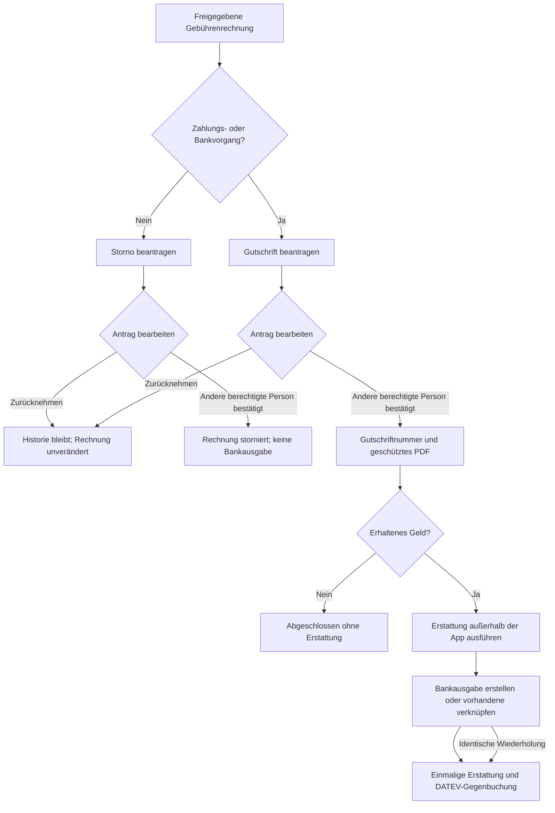

# T21-15 – Gebührenstorno und Gutschrift

Stand: 28.11.2026. Diese Anleitung betrifft ausschließlich weiterbelastete Rücklastschriftgebühren.

## Vorbereitung am Handy

Zwei getrennte berechtigte Vereinskonten A und B verwenden (z. B. Vereinsinhaber und Finanzverwaltung). Ein Antragsteller darf seinen eigenen Antrag nicht freigeben. Für den Test einen exportierten SEPA-Lauf mit zurückgegebener Position, erfasster Bankgebühr und bereits freigegebener Gebührenweiterbelastung verwenden. Für Storno und Gutschrift getrennte Testfälle anlegen.

1. Mit Konto A anmelden und den betreffenden Verein öffnen.
2. **Mitglieder & Beiträge** öffnen.
3. Zum Bereich **Beiträge & Zahlungen / Finanzen** wechseln und **SEPA-Sammellauf** antippen.
4. Den exportierten Lauf und die zurückgegebene Position öffnen.
5. **Gebühren weiterbelasten** antippen. Empfänger, Ursprungsrechnung, Gebührenrechnung und Betrag abgleichen.

## Storno ohne Zahlungs- oder Bankvorgang

1. **Storno beantragen** antippen.
2. Eine nachvollziehbare Begründung eingeben, die Bestätigung aktivieren und **Storno beantragen** antippen.
3. Den Vorgang erneut öffnen: Der Antrag muss als offen erscheinen. Solange er offen ist, werden keine neuen Storno- oder Gutschriftsanträge angeboten.
4. Zum Test der Rücknahme **Stornoantrag zurücknehmen** antippen, Begründung eingeben, bestätigen und absenden. Der zurückgenommene Antrag bleibt in der Historie; die Gebührenrechnung bleibt offen.
5. Einen neuen Stornoantrag stellen. Mit Konto B anmelden und dieselbe Position öffnen.
6. **Storno freigeben** antippen, bestätigen und absenden. Konto A bekommt diese Freigabe für den eigenen Antrag nicht angeboten.
7. Prüfen: Die Gebührenrechnung ist storniert, Nummer und Betrag bleiben erhalten. Es entsteht keine künstliche Bankausgabe, da kein Geld eingegangen ist.

Wenn zwischen Antrag und Freigabe eine Zahlung oder ein Bankvorgang hinzukommt, wird die Stornofreigabe abgewiesen. Antrag zurücknehmen und den Gutschriftweg prüfen.

## Gutschrift mit Zahlung oder Bankvorgang

1. Für den zweiten Fall eine Gebührenrechnung mit Zahlungsdatensatz, Bankzuordnung oder SEPA-Vorgang öffnen. Beispiel: Rechnung 2,00 EUR, tatsächlich bezahlt 0,50 EUR.
2. Mit Konto A **Gutschrift beantragen** antippen, Begründung eingeben, bestätigen und absenden.
3. Optional **Gutschriftantrag zurücknehmen** mit Begründung testen. Die Rechnung bleibt unverändert; anschließend ist ein neuer Antrag möglich.
4. Mit Konto B dieselbe Position öffnen, **Gutschrift freigeben** antippen, prüfen, bestätigen und absenden.
5. Prüfen: Die Gebührenrechnung ist storniert. Die Gutschrift hat eine eigene Nummer `AIR-GS-FEE-…`. Ursprüngliche Zahlungsbelege bleiben erhalten. Im Beispiel beträgt die Gutschrift 2,00 EUR, der Erstattungsbedarf aber nur 0,50 EUR.
6. **Gutschrift als PDF öffnen** antippen. Nummer, Empfänger, Ursprungsrechnung, Betrag, Begründung und Erstattungsbedarf prüfen. Bei einem Öffnungsfehler erscheint jetzt eine sichtbare Fehlermeldung.
7. Der App-Link ist fünf Minuten gültig. Nach Ablauf über die App einen neuen Link öffnen. Direkter API-Abruf und Linkausstellung erfordern Finanzrechte. Der signierte Link selbst ist während seiner Gültigkeit eine Zugriffsberechtigung; nicht weitergeben.

## Erstattung dokumentieren und Gegenbuchung prüfen

1. Nur den tatsächlich offenen Erstattungsbetrag außerhalb dieser Funktion überweisen. **Erstattung dokumentieren löst keine Banküberweisung aus.**
2. Wieder zur Gutschrift wechseln und **Erstattung dokumentieren** antippen.
3. Das tatsächliche Buchungsdatum im Format **TT.MM.JJJJ** und die eindeutige Bankreferenz eintragen. Das Datum muss zwischen Gutschriftfreigabe und heute liegen.
4. Falls die Bankausgabe bereits erfasst ist, deren Buchungs-ID eintragen. Betrag, Datum, Referenz und Verein müssen passen. Ohne ID erzeugt die Funktion eine neue Bankausgabe.
5. Angaben prüfen, Bestätigung aktivieren und absenden.
6. Vorgang erneut öffnen: **Erstattung dokumentiert** und Banknachweis müssen sichtbar sein. Es darf nur eine Bankausgabe bestehen.
7. Im DATEV-Export den Buchungsmonat prüfen: Der ursprüngliche Zahlungseingang bleibt auf dem eingefrorenen Erlöskonto mit `S` exportierbar. Die tatsächliche Erstattung erscheint einmalig mit `H` auf demselben Gegenkonto. Beispiel: 0,50 EUR Eingang im Oktober, 0,50 EUR Erstattung im November; keine Erstattung im Oktoberexport.
8. Bei unklarer Netzwerkantwort die angebotene identische Wiederholung verwenden und erneut bestätigen. UUID und Bankangaben bleiben eingefroren. Alternativ zuerst aktualisieren. Geänderte Daten mit derselben UUID werden abgewiesen.

Bei einer Gutschrift ohne erhaltenes Geld ist keine Erstattung erforderlich und die Erstattungsaktion fehlt.

## Automatisierte Prüfung und Grenzen

Ergebnis: **76 Backendtests mit 1.177 Assertions, 13 Webtests und 13 Flutter-Widgettests bestanden**. `git diff --check` ist sauber. Pint meldet bereits im unveränderten HEAD vorhandene Formatverstöße im Membership-Controller und in der Backend-Testdatei; diese wurden nicht großflächig umformatiert.

- Backend: `ClubSepaSettlementTest` prüft Anträge, Rücknahme, Vier-Augen-Freigabe, Belegerhalt, Zugriffsrechte, manipulierte und abgelaufene Links, Erstattungswiederholung, Audit-Rollback und periodengerechten DATEV-Export.
- Web: `feeRechargeState.test.mjs` und `feeRechargeRender.test.mjs` prüfen Bestätigungen, eingefrorene Wiederholungen und gegenseitigen Ausschluss offener Anträge.
- App: `club_sepa_fee_recharge_test.dart` prüft Rollen, Anträge, Wiederholungen, Dokumentlink, sichtbaren Dokumentfehler und den gegenseitigen Ausschluss.
- Eine manuelle Realgeräte-, Bank- oder MySQL-Konkurrenzabnahme wurde in diesem Arbeitsschritt nicht durchgeführt. Die Anleitung dient dieser noch ausstehenden Abnahme. Keine Produktivmigration und kein Push.
